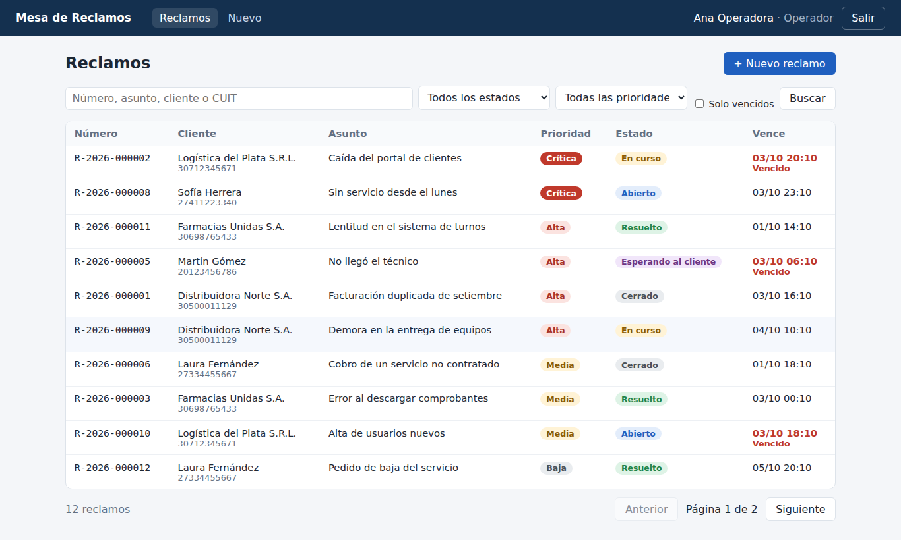
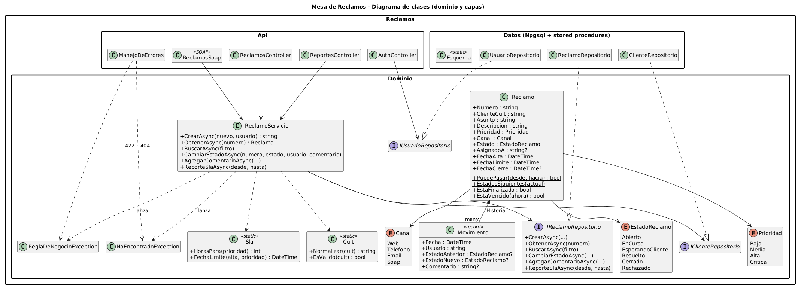
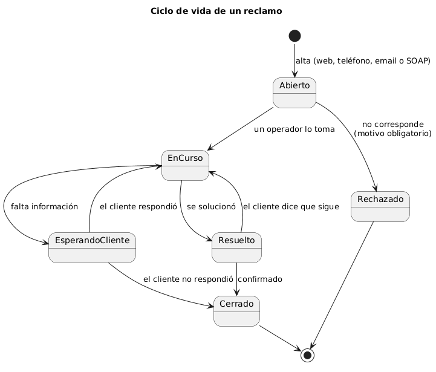
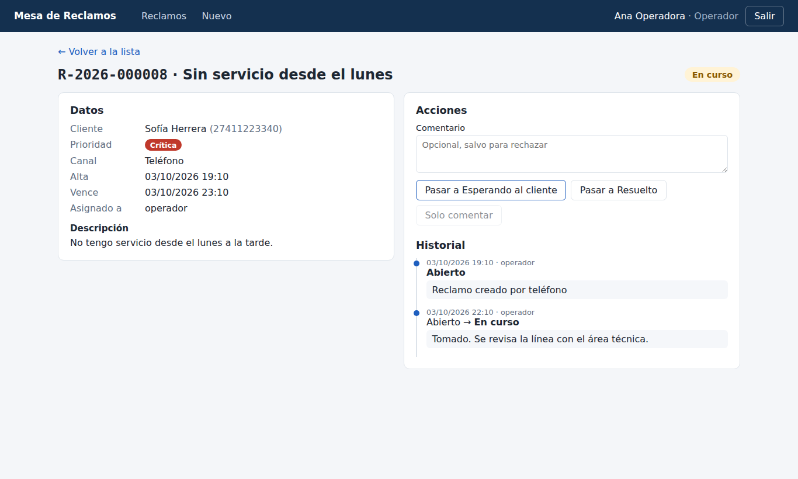
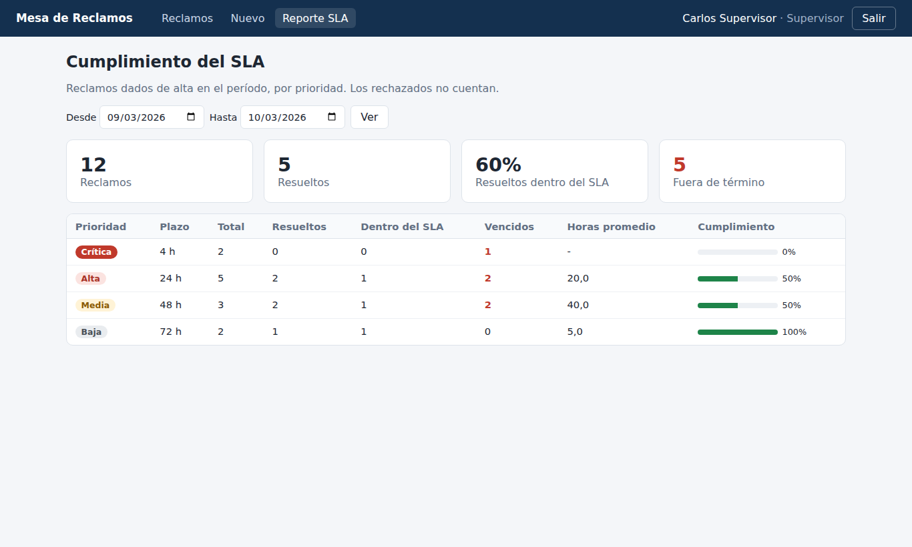

# Complaints Desk (Mesa de Reclamos)

[Versión en español](README.md)

A system for a customer service center to log and track customer complaints. Each complaint has a priority with a resolution deadline (SLA), moves through controlled states and keeps a full history. Operators work from a web interface, and other company systems (for example, the phone switchboard) create complaints through a SOAP service.

Built with **.NET 10 (ASP.NET Core)**, **Angular 21** and **PostgreSQL**, with the data logic in **stored procedures**. The code, UI and data are in Spanish.



## Features

- **Complaints with an SLA:** the priority sets the deadline (Critical 4 h, High 24 h, Medium 48 h, Low 72 h). The list flags overdue complaints and can be filtered by state, priority, text or overdue only, with paging.
- **Controlled states:** Open → In progress → Waiting for customer / Resolved → Closed, or Rejected (a reason is required). Valid transitions are checked in C# and again in the stored procedure, so the database never ends up inconsistent.
- **History:** every state change and comment is recorded with its date and user.
- **SLA report** for supervisors: per priority, how many were resolved, how many on time, how many were overdue, and the average time.
- **SOAP service** (CoreWCF) with two operations, `AltaReclamo` (create) and `ConsultarReclamo` (query), a public WSDL and a key in the `X-Api-Key` header. Includes a C# console client.
- **Security:** JWT login with roles (Operator, Supervisor), PBKDF2 password hashing, parameterized queries everywhere, and ProblemDetails errors without internal details.

## Architecture

```
web/                    Angular 21: login, list, detail, create and report
src/Reclamos.Api        ASP.NET Core: REST API (controllers), SOAP service, JWT, error handling
src/Reclamos.Dominio    Entities and business rules (OOP): Reclamo, Sla, Cuit, ReclamoServicio, interfaces
src/Reclamos.Datos      Npgsql repositories that call stored procedures; SQL scripts in Sql/
src/Reclamos.ClienteSoap  Console client for the SOAP service
tests/Reclamos.Tests    42 xUnit tests: domain, service, full API and SOAP against PostgreSQL
e2e/recorrido.mjs       Playwright walkthrough of the UI (14 checks)
docs/uml                UML diagrams (PlantUML): classes, states, sequence and data model
```

The REST API and the SOAP service share the same `ReclamoServicio` class, so both entry points apply the same rules. Controllers know nothing about SQL, and the domain knows nothing about HTTP or PostgreSQL: it depends on interfaces (`IReclamoRepositorio`) implemented by the data layer.

| Class diagram | Lifecycle |
|---|---|
|  |  |

There is also a [sequence diagram](docs/uml/secuencia.png) of a state change and the [data model](docs/uml/der.png).

## Stored procedures

They live in [src/Reclamos.Datos/Sql/002_procedimientos.sql](src/Reclamos.Datos/Sql/002_procedimientos.sql). Writes are `PROCEDURE`s (called with `CALL`) and reads are table-returning functions.

| Name | What it does |
|---|---|
| `sp_reclamo_crear` | Checks the customer, builds the number (R-2026-000001), inserts the complaint and its first history row. Returns the number in an `INOUT` parameter. |
| `sp_reclamo_cambiar_estado` | Locks the row with `FOR UPDATE`, checks the transition against the `estado_transiciones` table, updates and writes the history. |
| `sp_reclamo_comentar` | Adds a comment to the history. |
| `fn_reclamos_buscar` | Filtered, paged search; the total comes on every row via `COUNT(*) OVER ()`. |
| `fn_reclamo_obtener`, `fn_reclamo_historial` | One complaint and its history. |
| `fn_reporte_sla` | SLA compliance report per priority. |

Business errors are raised with custom codes (`SQLSTATE 'RC404'` and `'RC422'`). The data layer translates them into domain exceptions, which the API returns as 404 and 422.

## Running it

You need the .NET 10 SDK, Node.js 22 and PostgreSQL.

1. Create the database:

   ```sql
   CREATE ROLE reclamos LOGIN PASSWORD 'reclamos';
   CREATE DATABASE reclamos OWNER reclamos;
   ```

2. Build the UI (once):

   ```bash
   cd web
   npm install
   npm run build
   ```

3. Start the API, which also serves the UI. In development it creates the tables, the stored procedures and sample data:

   ```bash
   cd src/Reclamos.Api
   dotnet run
   ```

4. Open http://localhost:5292 and log in as `operador` or `supervisor`, password `demo1234`.

Development settings are in `src/Reclamos.Api/appsettings.Development.json`. In production the connection string, JWT key and SOAP key come from environment variables (`ConnectionStrings__Reclamos`, `Jwt__Clave`, `Soap__ApiKey`) and no sample data is loaded.

### SOAP service

- WSDL: http://localhost:5292/soap/reclamos?wsdl
- Console client:

  ```bash
  cd src/Reclamos.ClienteSoap
  dotnet run -- alta 30500011129 Alta "Sin conexión" "No hay servicio en la sucursal Centro"
  dotnet run -- consulta R-2026-000001
  ```

Responses carry a code (00 OK, 04 not found, 08 invalid data, 16 internal error) instead of a SOAP Fault, as integration services often do.

## Tests

```bash
# Needs an empty test database (dropped and recreated on every run)
psql -c "CREATE DATABASE reclamos_test OWNER reclamos"
dotnet test
```

The integration tests start the whole API with `WebApplicationFactory` against the `reclamos_test` database (override with the `RECLAMOS_TEST_BD` variable). Among other things they cover login, role permissions, the full lifecycle, the stored procedure rejecting transitions even when the C# check is bypassed, two simultaneous changes on the same complaint not overwriting each other, a SQL injection attempt, the report math with controlled dates, and the SOAP service with and without a key.

Run the UI walkthrough with the API up:

```bash
cd e2e
npm install
npx playwright install chromium
node recorrido.mjs
```

## Screenshots

| Detail and history | SLA report |
|---|---|
|  |  |

## Notes

- The database is PostgreSQL. The same procedures can be written for SQL Server (T-SQL), Oracle (PL/SQL) or DB2 SQL PL; the syntax changes, the design doesn't.
- The SOAP service uses CoreWCF, the modern .NET version of WCF. It plays the same role as an ASMX Web Service in .NET Framework.
